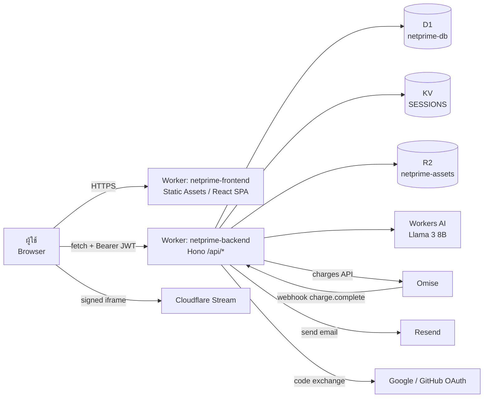
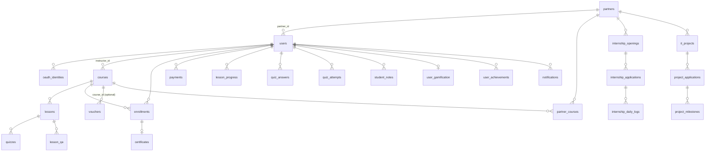

# สถาปัตยกรรมระบบ Netprime LMS (System Architecture)

เอกสารส่งต่อสำหรับทีม web development · จัดทำ 24 ตุลาคม 2026 จากโค้ดใน workspace ปัจจุบัน (ยังไม่มี Git history)

## 1. ภาพรวม

Netprime LMS คือระบบจัดการการเรียนรู้ (Learning Management System) แบบ serverless ที่ทำงานบน Cloudflare ทั้งหมด รองรับ 4 บทบาท และ 3 กลุ่มธุรกิจ:

| กลุ่ม | ความหมาย |
| --- | --- |
| B2C | ผู้เรียนทั่วไปสมัครเอง ซื้อคอร์สรายบุคคล (ชำระผ่าน Omise) |
| B2B (company) | บริษัทซื้อที่นั่ง (seats) ให้พนักงาน HR จัดการรายชื่อและกำหนดคอร์ส |
| University | มหาวิทยาลัยดูแลนักศึกษา ติดตามการฝึกงาน (internship) และอนุมัติ log |

ฟีเจอร์เสริม: gamification (EXP/level/badge/streak), AI tutor, ตลาดงาน IT outsource (project → bid → milestone), ใบประกาศนียบัตรพร้อมหน้าตรวจสอบสาธารณะ

## 2. Technology stack

| ชั้น | เทคโนโลยี | ไฟล์หลัก |
| --- | --- | --- |
| Frontend | React 18 + TypeScript + Vite 5, framer-motion, lucide-react (SPA ไม่มี router library) | `frontend-admin/` |
| Hosting frontend | Cloudflare Workers Static Assets (`not_found_handling: single-page-application`) | `frontend-admin/wrangler.jsonc` |
| Backend API | Hono 4 บน Cloudflare Workers, JWT (`@tsndr/cloudflare-worker-jwt`) | `backend/src/` |
| Database | Cloudflare D1 (SQLite) 26 ตาราง | `backend/schema.sql`, `backend/migrations/` |
| File storage | Cloudflare R2 (handout PDF, วิดีโอ) | binding `ASSETS` |
| Session | Cloudflare KV (token ที่ logout แล้ว, OAuth state) | binding `SESSIONS` |
| AI | Workers AI `@cf/meta/llama-3-8b-instruct` | binding `AI` |
| วิดีโอ | Cloudflare Stream (signed URL), YouTube/Vimeo, หรือไฟล์ R2 (รองรับ Range) | `utils/stream.ts` |
| ภายนอก | Omise (ชำระเงิน THB), Resend (อีเมล), Google/GitHub OAuth | |
| เครื่องมือ | pnpm workspace, Wrangler, Node test runner | `package.json`, `scripts/test-local.mjs` |

## 3. แผนภาพสถาปัตยกรรม



ทั้งสองส่วน deploy เป็น Worker แยกกัน frontend เรียก API ผ่าน `VITE_API_BASE_URL` (ฝังตอน build) backend ตรวจ CORS จาก `FRONTEND_ORIGINS`

## 4. โครงสร้างโฟลเดอร์

```
netprime lms/
├── package.json            # สคริปต์รวม: check, test, dev, deploy
├── pnpm-workspace.yaml     # workspace: backend, frontend-admin
├── backend/
│   ├── wrangler.jsonc        # config production (D1/R2/KV/AI)
│   ├── wrangler.local.jsonc  # config ทดสอบบนเครื่อง (mock secrets)
│   ├── schema.sql            # DROP + CREATE + seed เดโม (ใช้กับ local เท่านั้น)
│   ├── migrations/0001–0004  # migration เพิ่มเติมสำหรับฐานข้อมูลเดิม
│   └── src/
│       ├── index.ts          # Hono app, CORS, error handler, mount routers
│       ├── middleware/rbac.ts# ตรวจ JWT + KV revocation + โหลด user จาก D1 + ตรวจ role
│       ├── handlers/         # 11 router modules (ดูหัวข้อ 6)
│       └── utils/            # crypto (PBKDF2), email, stream, gamification, origins, session
├── frontend-admin/
│   ├── wrangler.jsonc        # deploy dist/ เป็น static assets
│   └── src/
│       ├── App.tsx           # เลือกหน้าตาม role + OAuth callback + verify certificate
│       ├── hooks/useApi.ts   # fetch wrapper, token ใน localStorage
│       ├── components/       # VideoPlayer, MetricsCard
│       └── pages/            # Landing, Dashboard (ผู้เรียน), InstructorConsole,
│                             # HRConsole (partner), AdminConsole, VerifyCertificate
├── tests/                  # smoke, auth, business, learning, outsource, readiness, password
├── scripts/test-local.mjs  # สร้าง D1/KV/R2 ชั่วคราว รัน Worker แล้วรันเทสต์
└── docs/                   # เอกสารทั้งหมด (ภาษาไทย)
```

## 5. บทบาทและหน้าจอ (Frontend)

`App.tsx` ไม่มี URL routing — หลัง login จะแสดงหน้าตาม `user.role`:

| Role | หน้าจอ | ขนาด | งานหลัก |
| --- | --- | --- | --- |
| (ไม่ login) | `Landing.tsx` | 1,854 บรรทัด | catalog, login/signup, OAuth |
| (สาธารณะ) | `VerifyCertificate.tsx` | 296 | ตรวจใบประกาศจาก `?code=NP-…` |
| student | `Dashboard.tsx` | 4,177 | เรียนวิดีโอ, quiz, note, Q&A, AI tutor, code sandbox, ซื้อคอร์ส, ใบประกาศ, internship, outsource, gamification |
| instructor | `InstructorConsole.tsx` | 2,872 | CRUD course/lesson/quiz, upload, voucher, group, telemetry, ตอบ Q&A |
| partner | `HRConsole.tsx` | 2,678 | seats/roster, assign คอร์ส, analytics, internship, outsource + AI scope/audit |
| admin | `AdminConsole.tsx` | 396 | analytics รวม, รายชื่อผู้ใช้, สร้างองค์กร |
| ตามสิทธิ์ `site.*` | `SiteManager.tsx` + `components/site-admin/` | — | จัดการเว็บไซต์: รอบอบรม/ผู้สมัคร, ข้อความติดต่อ, โปรโมชั่น, ตั้งค่า, ประวัติแก้ไข ([คู่มือ](ADMIN-GUIDE.md)) แสดงเฉพาะแท็บที่มีสิทธิ์ |
| ตามสิทธิ์ `articles.*` | `ArticlesStudio.tsx` + `components/editor/ArticleEditor.tsx` (BlockNote, lazy chunk) | — | เขียน/ตรวจ/เผยแพร่บทความ, นำเข้าและฝัง Notion |
| ตามสิทธิ์ `users.view`, `roles.manage` | `UsersPage.tsx` | — | จัดการผู้ใช้ทุกประเภท และตารางสิทธิ์ต่อ role |

หน้าจอใหญ่มากและรวม logic ไว้ในไฟล์เดียว JS bundle เดียว 1.37 MB (gzip 287 kB)

## 6. Backend API (prefix `/api`)

ทุก route ที่ต้อง login ใช้ `rbac([roles])` ซึ่ง (1) ตรวจ Bearer JWT (2) ดู KV ว่า token ถูก revoke หรือไม่ (3) โหลด user ล่าสุดจาก D1 (4) ตรวจ role

หลัง `rbac()` บาง route ใช้ `permit(...permissions)` (`utils/permissions.ts`) ตรวจสิทธิ์ย่อยจากตาราง `role_permissions` (admin ได้ทุกสิทธิ์เสมอ) เช่น `site.sessions`, `articles.publish`, `users.manage` · `rbac()` ยังปฏิเสธบัญชีที่ `status = 'suspended'` และ token ที่ออกก่อน `users.sessions_revoked_at` (claim `iat_ms`) · `/auth/login` และ `/auth/me` ส่ง `permissions` ให้ frontend ใช้ซ่อนเมนู

1 บัญชีมีได้หลายบทบาท (ตาราง `user_roles`) `rbac([roles])` ผ่านเมื่อมีบทบาทใดบทบาทหนึ่งที่อนุญาต และตั้ง `user.role` เป็นบทบาทสูงสุดที่ route นั้นอนุญาต (ลำดับ admin > coordinator > instructor > partner > student) `user.roles` มีครบทุกบทบาท สิทธิ์ (`permit`) เป็นสิทธิ์รวมของทุกบทบาท ส่วน `users.role`/`staff_role` เก็บบทบาทหลักไว้ให้ query เดิม (ที่นั่ง, รายชื่อผู้เรียน, leaderboard) ทำงานต่อได้

บทบาทหลักคือ `COALESCE(staff_role, role)`: บัญชีเจ้าหน้าที่ประสานงานมี `role = student` และ `staff_role = coordinator` จึงได้ role `coordinator` ซึ่งผ่านเฉพาะ `/api/admin/site/*` query ที่ดึงรายชื่อผู้เรียนต้องกรอง `staff_role IS NULL` ด้วย

| Module | ไฟล์ | Endpoint หลัก |
| --- | --- | --- |
| Auth | `auth.ts` | `POST /auth/register`, `/auth/login`, `/auth/logout`, `GET /auth/me`, `GET /auth/oauth/providers`, `GET /auth/oauth/:provider/url`, `POST /auth/oauth/:provider/callback` |
| Courses | `courses.ts` | `GET /courses`, `/courses/:id`, `POST /courses/:id/enroll`, `GET /lessons/:id/video`, `GET /certificates/verify/:code` (สาธารณะ) |
| Student | `student.ts` | quiz (`/student/courses/:id/quizzes`, `/student/quizzes/:id/submit`), voucher, `POST /student/checkout/session`, `POST /payment/omise-webhook`, handout, notes, lesson progress, certificate, `GET /student/video` (R2 + Range), Q&A, stats |
| Instructor | `instructor.ts` | analytics, CRUD courses/lessons/quizzes, assign, enrollments, vouchers, groups/members, upload (`/upload`, `/upload/presign`, `PUT /upload/direct`), telemetry, Q&A |
| Business | `business.ts` | analytics, seats/roster, partners, courses, assign คอร์สให้พนักงาน |
| Internship | `internship.ts` | openings, applications, daily logs, อนุมัติฝั่งบริษัท/มหาวิทยาลัย |
| Outsource | `outsource.ts` | projects, apply (bid), candidates, accept, milestones submit/approve, AI scope generator, AI PM audit |
| Gamification | `gamification.ts` | profile, leaderboard |
| Notifications | `notifications.ts` | list, read-all |
| AI | `ai.ts` | `POST /ai/chat` (student) |
| Admin | `admin.ts` | analytics, users, `POST /admin/corporates` |
| Accounts | `accounts.ts` | `GET/POST /admin/accounts`, `PATCH /admin/accounts/:id`, `POST /admin/accounts/:id/password`, `/sign-out`, `GET /admin/roles`, `PUT /admin/roles/:role` |
| Website (สาธารณะ) | `site.ts` | `GET /public/site`, `/public/sessions`, `/public/sessions/:id`, `POST /public/sessions/:id/register`, `GET /public/articles`, `/public/articles/:slug`, `POST /public/inquiries`, `GET /public/images/:name` |
| Website (admin) | `site.ts` | `/admin/site/summary`, sessions CRUD + duplicate, registrations (list/add/patch/delete/CSV), inquiries, articles (draft/review/published + `POST /admin/site/articles/import-notion` ผ่าน `utils/notion.ts`), promotions, settings, images, audit |

รวมประมาณ 100 endpoints

## 7. ฐานข้อมูล (D1)



| กลุ่ม | ตาราง |
| --- | --- |
| บัญชี/องค์กร | `partners` (company/university, total/allocated seats), `users` (role), `oauth_identities` |
| เนื้อหา | `courses` (price, access_duration_days), `lessons` (video provider/uid, handout_r2_key), `quizzes` |
| การเรียน | `enrollments` (status, expires_at), `lesson_progress`, `quiz_answers` (คะแนนจาก server), `quiz_attempts`, `student_notes`, `lesson_qa`, `certificates` |
| การขาย | `payments` (pending/completed/failed, provider_charge_id), `vouchers`, `partner_courses` (คอร์สที่องค์กรสนับสนุน) |
| กลุ่มเรียน | `student_groups`, `student_group_members` |
| อาชีพ | `internship_openings`, `internship_applications`, `internship_daily_logs`, `it_projects`, `project_applications`, `project_milestones` |
| Gamification | `user_gamification`, `achievements`, `user_achievements`, `notifications` |
| เว็บไซต์ (migration 0005) | `training_sessions`, `session_registrations`, `articles`, `inquiries`, `promotions`, `site_settings`, `admin_audit_log` |

## 8. Flow สำคัญ

**Login (password)** — `POST /auth/login` → ตรวจ PBKDF2-SHA256 (100,000 รอบ; อัปเกรด hash เก่าอัตโนมัติ) → ออก JWT อายุ 24 ชม. → frontend เก็บใน `localStorage` → ส่ง `Authorization: Bearer` ทุก request → logout เขียน hash ของ token ลง KV จนหมดอายุ

**OAuth** — frontend ขอ URL → backend สร้าง `state` เก็บ KV 10 นาที → redirect ไป provider → กลับมา `/auth/callback/:provider?code=` → backend แลก code, ผูกกับ `oauth_identities` (email ที่มีบัญชีอยู่แล้วจะต้องผูกบัญชีก่อน) Microsoft ยังปิดอยู่

**ซื้อคอร์ส** — `POST /student/checkout/session` (ต้องมี `omise_token`) → server คิดราคา + voucher → สร้าง `payments` pending → สร้าง charge ที่ Omise → Omise เรียก webhook → server **อ่าน charge จาก Omise ซ้ำ** ตรวจ status/amount/currency/เจ้าของ → batch: payment completed + enrollment

**เรียนจบและใบประกาศ** — progress คำนวณบน server จาก `lesson_progress` + `quiz_answers` เกณฑ์: เรียนครบทุกบท และตอบ quiz ถูก ≥ 80% → ออก `certificates` รหัส `NP-…` → ตรวจได้ที่ `/verify-certificates?code=…`

**ลงทะเบียนรอบอบรม** — ฟอร์มหน้าเว็บ → honeypot/rate limit/Turnstile → `INSERT … SELECT` ที่ตรวจที่นั่งในคำสั่งเดียว (กันจองเกิน) → ถ้าเต็มบันทึกเป็น `waitlist` → อีเมลผู้สมัครและเจ้าหน้าที่ผ่าน `waitUntil` → เจ้าหน้าที่เปลี่ยนสถานะใน console (ตรวจที่นั่งซ้ำตอนเปลี่ยน)

**B2B seat** — HR เพิ่มพนักงาน → batch INSERT user + UPDATE `allocated_seats` แบบมีเงื่อนไข (ไม่เกิน `total_seats`)

## 9. การทดสอบ

`pnpm run check:release` (ตรวจซ้ำ 24 ต.ค. 2026 ผ่านทั้งหมด): TypeScript ทั้งสองส่วน, password 3, smoke 15, auth 12, outsource 2, business 2, learning 2, readiness 11, site 9 และ frontend build เทสต์ใช้ D1/KV/R2 ชั่วคราวบนเครื่อง ไม่เรียกบริการภายนอกจริง ยังไม่มี UI/E2E test

## 10. เอกสารที่เกี่ยวข้อง

- [ADMIN-GUIDE.md](ADMIN-GUIDE.md) — คู่มือเจ้าหน้าที่จัดการเว็บไซต์
- [GAP-ANALYSIS.md](GAP-ANALYSIS.md) — สิ่งที่ยังไม่สมบูรณ์และต้องทำก่อนเปิดใช้งาน
- [CLOUDFLARE-DEPLOY.md](CLOUDFLARE-DEPLOY.md) — วิธีตั้งค่าและ deploy บน Cloudflare
- [DEVELOPMENT-PLAN.md](DEVELOPMENT-PLAN.md), [PROJECT-READINESS.md](PROJECT-READINESS.md), [TESTING.md](TESTING.md) — แผนเดิม รายงาน baseline และคู่มือ UAT
